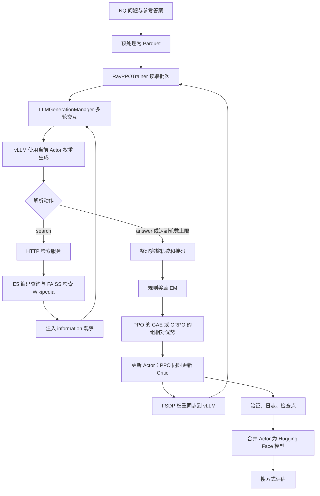

# Search-R1-Qwen3 项目设计与 Agentic RL 训练流程

本文根据本仓库当前源码与本机配置整理，描述默认 **Qwen2.5-3B + Natural Questions（NQ）+ E5/Wikipedia 检索 + FSDP/vLLM** 的执行路径。仓库名称包含 Qwen3，但当前复现脚本使用 Qwen2.5-3B 基础模型。

## 1. 项目训练的能力是什么

模型面对问题时，需要自行决定：继续推理、提出搜索词、阅读搜索结果，或者给出最终答案。强化学习优化的是整个决策轨迹中的模型生成行为，包括搜索请求与答案文本。

交互协议如下：

| 标签 | 含义 | 内容来源 |
|---|---|---|
| `<think>...</think>` | 推理过程 | 模型生成，提示词要求使用 |
| `<search>...</search>` | 搜索动作及查询词 | 模型生成，程序解析并执行 |
| `<information>...</information>` | 检索观察 | 检索服务返回，由程序注入上下文 |
| `<answer>...</answer>` | 最终答案 | 模型生成，程序终止该轨迹并评分 |

例如，一条轨迹可以是：

```text
用户问题
→ <think>还需要确认某项事实</think>
→ <search>查询词</search>
→ <information>检索到的三条资料</information>
→ <think>根据资料继续推理</think>
→ <answer>最终答案</answer>
```

这里的 Agentic RL 来自“模型动作—环境反馈—后续动作—终局奖励”的闭环。训练不需要为每道题提供标准搜索轨迹；数据提供问题和正确答案，模型通过在线采样探索如何搜索和回答。检索编码器和 FAISS 索引在默认训练中保持固定，不参与策略梯度更新。

`<think>` 是提示词约定；动作解析器实际识别的是 `<search>` 与 `<answer>`，并没有独立校验推理文本是否正确。

## 2. 系统全景



系统分为两个独立进程体系：

- **训练端**：Ray 调度工作进程；FSDP 负责训练模型；vLLM 负责采样；训练器负责奖励、优势与更新顺序。
- **检索端**：FastAPI 提供 `/retrieve`，E5 编码查询，FAISS 查找文档，Wikipedia 语料提供正文。

两端通过 HTTP 交换查询与检索结果。搜索服务是环境的一部分，训练进程不对 HTTP 调用或检索算法做反向传播。

## 3. 目录与模块职责

### 3.1 顶层目录

| 目录 | 职责 | 默认执行路径中的位置 |
|---|---|---|
| `verl/` | 仓库内置的强化学习框架，包含训练器、模型工作进程、分布式调度、数据协议与工具 | 核心实现 |
| `verl/llm_agent/` | Search-R1 多轮生成、动作解析、搜索调用、观察拼接与掩码生成 | 默认训练器实际导入此目录 |
| `llm_agent/` | 另一套同名生成与张量辅助实现 | 默认训练器不导入根目录这套代码；修改搜索循环应优先定位 `verl/llm_agent/` |
| `search/` | 本地检索服务、索引构建、离线检索、在线搜索服务与重排序 | 独立运行的工具环境 |
| `scripts/` | 资源下载、校验、本地环境配置、检索启动及数据准备工具 | 训练前准备与运行辅助 |
| `scripts/data_process/` | 将问答数据转换为 veRL 的训练格式并生成提示词 | `nq_search.py` 为当前数据入口 |
| `examples/` | PPO、GRPO 与数据预处理示例 | 通用参考，不是当前根目录脚本的入口 |
| `examples/ppo_trainer/` | PPO 训练示例与说明 | 参考配置 |
| `examples/grpo_trainer/` | GRPO 训练示例与说明 | 参考配置 |
| `examples/data_preprocess/` | 其他数据预处理示例 | 数据扩展参考 |
| `docs/` | 项目设计文档 | 本文所在目录 |
| `logs/` | 本地安装、资源校验、训练、检索与验证日志 | 运行产物 |
| `outputs/` | Hydra 的按运行时间组织的输出与配置快照 | 运行产物 |
| `.git/` | Git 版本管理数据 | 不参与训练 |
| 各级 `__pycache__/` | Python 字节码缓存 | 自动生成，不属于业务模块 |

以下目录由实际运行或后处理产生，当前不一定存在：

| 目录 | 内容 |
|---|---|
| `verl_checkpoints/` | FSDP 分布式训练检查点，按实验名和 `global_step_*` 保存 |
| `models/` | **仓库内**的合并后模型；当前 `scripts/common/merge.sh` 输出到这里 |
| `inference/` | 评估轨迹与预测 JSONL |
| `wandb/` | 离线 W&B 记录 |

基础模型与数据位于仓库外：`/home/jk/work/models/` 和 `/home/jk/work/datasets/`。不要把仓库内的 `models/` 合并产物目录与外部基础模型目录混淆。

### 3.2 `verl/` 内部模块

| 目录或文件 | 职责 |
|---|---|
| `protocol.py` | `DataProto`：统一传递张量批次、非张量字段和元信息，支持重复、合并、切分、重排 |
| `trainer/` | 训练、评估、SFT 等主入口与总体编排 |
| `trainer/config/` | Hydra 配置；`actor/`、`critic/`、`ref/`、`rollout/`、`reward_model/` 分别配置对应角色；`data/` 配置数据；`npu_profile/` 为其他硬件的分析配置 |
| `trainer/ppo/` | `ray_trainer.py` 为默认主循环；`core_algos.py` 实现优势估计、策略损失、价值损失和 KL 等算法；`reward.py` 加载奖励管理器 |
| `llm_agent/` | `generation.py` 执行搜索式交互；`tensor_helper.py` 处理 padding、长度、attention mask 与位置编码 |
| `workers/` | GPU 工作进程；默认 FSDP 路径以 `fsdp_workers.py` 为入口，另有 Megatron 等后端 |
| `workers/actor/` | Actor 的 log probability 计算与策略梯度更新，默认使用 `dp_actor.py` |
| `workers/critic/` | PPO 价值预测与 Critic 更新 |
| `workers/rollout/` | 采样后端，包含 vLLM、SGLang、HF 等实现；默认走 `vllm_rollout/` |
| `workers/reward_manager/` | 将完整响应和参考答案交给评分函数，再把标量奖励放到 token 奖励张量中 |
| `workers/reward_model/` | 可选的学习式奖励模型实现；默认 NQ 实验不启用 |
| `workers/sharding_manager/` | 协调训练分片与推理权重表示，进行 FSDP→vLLM 权重同步及推理引擎休眠/唤醒 |
| `workers/config/` | 各工作角色的数据类配置与校验 |
| `workers/roles/` | Actor、Critic 等角色抽象 |
| `workers/engine/` | FSDP、Megatron 等训练引擎抽象与实现 |
| `single_controller/base/` | 工作进程、调用分发和资源控制的基础抽象 |
| `single_controller/ray/` | Ray 工作组、远程调用、资源池等分布式实现 |
| `models/` | 模型适配；`transformers/` 为 HF 模型补丁和前向适配，`llama/`、`qwen2/` 为模型实现，`mcore/` 为 Megatron 模型相关代码 |
| `model_merger/` | 将分布式模型检查点合并为可加载的模型格式 |
| `third_party/` | 与 `torch/`、`vllm/`、`sglang/` 集成的兼容代码 |
| `tools/` | 通用工具接口、搜索/MCP、代码沙箱、数学及图像工具；`utils/` 提供工具注册和辅助逻辑 |
| `interactions/` | 通用交互环境接口、交互注册与任务交互实现 |
| `experimental/agent_loop/` | 新的通用单轮/工具 Agent loop 实现；不是默认 Search-R1 的生成管理器 |
| `experimental/dataset/` | 数据采样扩展接口 |
| `experimental/dynamic_dataset/` | 动态数据生成与数据集扩展 |
| `version/` | 内置 veRL 版本信息 |

`verl/utils/` 的职责进一步划分为：

| 子目录 | 职责 |
|---|---|
| `dataset/` | RL/SFT 数据读取、tokenization 与批次整理 |
| `reward_score/` | 按数据源分发的规则评分，包括本项目的 `search_r1_like_qa_em.py`；数学、代码、沙箱评分为其他任务扩展 |
| `checkpoint/` | 检查点保存、加载及 FSDP 状态管理 |
| `kernel/` | 性能相关计算内核 |
| `profiler/` | GPU 内存、时间及分析工具配置 |
| `debug/` | 调试与指标辅助 |
| `metric/` | 指标工具 |
| `logger/` | 日志辅助 |
| `megatron/` | Megatron 后端辅助 |
| `vllm/` | vLLM 集成辅助 |
| `rendezvous/` | 分布式会合辅助 |
| `experimental/` | 实验性辅助能力 |

此外，`utils/` 根目录提供模型与 tokenizer 加载、FSDP、张量操作、设备、文件访问、跟踪和兼容性工具。

### 3.3 关键启动文件

| 文件 | 用途 |
|---|---|
| `scripts/ppo/train.sh` | 用 GAE/PPO 训练 Qwen2.5-3B |
| `scripts/grpo/train.sh` | 使用同一训练入口，以 GRPO 优势估计、每题 4 次采样训练 |
| `scripts/ppo/eval.sh`、`scripts/grpo/eval.sh` | 对合并模型执行带搜索的验证，并整理 JSONL 输出 |
| `scripts/common/merge.sh` | 调用 `python -m verl.model_merger merge`；参数为 `ppo` 或 `grpo`，省略时默认 GRPO |
| `scripts/local_env.sh` | 激活本地训练环境，配置缓存、模块路径及训练 GPU |
| `scripts/retrieval/start_local.sh` | 激活检索环境，使用本地 E5、语料和 CPU FAISS 索引启动服务 |
| `scripts/download_local_assets.py` | 下载固定版本的模型和 NQ/检索资源 |
| `scripts/download_large_assets.py` | 大权重、索引与语料的分块下载、重试和续传；并发可用 `DOWNLOAD_WORKERS` 配置 |
| `scripts/prepare_local_data.py` | 拼接官方索引分片并解压 Wikipedia |
| `scripts/verify_local_assets.py` | 对已存在的模型权重、原始索引分片与压缩语料校验上游 SHA256 |
| `scripts/download.py`、`download.sh` | 原始资源下载辅助入口 |
| `scripts/upload.py`、`upload.sh` | 资源上传辅助，不在默认训练路径中执行 |
| `search/retrieval_server.py` | 当前默认的 FastAPI 本地检索服务 |
| `search/index_builder.py`、`build_index.sh` | 为自有语料构建检索索引 |
| `search/retrieval.py`、`retrieval.sh`、`retrieval_request.py` | 离线检索与请求辅助 |
| `search/google_search_server.py`、`serp_search_server.py` | 在线搜索服务适配 |
| `search/rerank_server.py`、`retrieval_rerank_server.py` | 重排序及检索+重排序服务 |
| `search/retrieval_server_v1.py` | 另一版检索服务实现，不是当前默认启动脚本使用的文件 |

## 4. 训练前：模型、数据与环境

### 4.1 本地资源

| 资源 | 路径 | 作用 |
|---|---|---|
| Qwen2.5-3B Base | `/home/jk/work/models/Qwen2.5-3B` | Actor 初始权重；PPO Critic 也从此模型初始化；启用参考策略时作为其初始模型 |
| E5-base-v2 | `/home/jk/work/models/e5-base-v2` | 固定的查询编码器 |
| NQ 原始数据 | `/home/jk/work/datasets/FlashRAG_datasets/nq/` | 问题与 `golden_answers` |
| 训练/测试 Parquet | `/home/jk/work/datasets/nq_search/train.parquet`、`test.parquet` | 训练器的数据输入；分别 79,168 与 3,610 条 |
| Wikipedia | `/home/jk/work/datasets/nq_search/wiki-18.jsonl` | 21,015,324 条可检索资料 |
| E5 索引 | `/home/jk/work/datasets/nq_search/e5_Flat.index` | 768 维、约 64.6GB 的稠密索引 |
| 资源清单 | `/home/jk/work/datasets/assets-manifest.json` | 源版本与文件校验信息 |

训练环境为 `/home/jk/work/envs/searchr1-verl`；检索环境为 `/home/jk/work/envs/searchr1-retriever`。本机训练采用 Python 3.10、PyTorch 2.6.0、vLLM 0.8.5、Transformers 4.51.3、FlashAttention 2.7.4.post1。完整依赖见根目录两个 `requirements-*.txt`。

### 4.2 数据预处理

`nq_search.py` 给问题添加搜索交互说明，再生成以下结构：

```python
{
    "data_source": "nq",
    "prompt": [{"role": "user", "content": "交互协议说明 + 问题"}],
    "ability": "fact-reasoning",
    "reward_model": {
        "style": "rule",
        "ground_truth": {"target": ["可接受答案1", "可接受答案2"]},
    },
    "extra_info": {"split": "train", "index": 0},
}
```

训练时，`RLHFDataset` 读取 Parquet，将提示词转换为 token，并保留参考答案等非张量字段。参考答案用于评分，不作为正常问题提示词交给 Actor。

### 4.3 检索服务

服务启动时加载索引、语料与 E5。收到请求后：

1. 将查询用 E5 编码并归一化。
2. 在 FAISS 中批量检索 top-k 向量。
3. 用文档索引从语料取回 `contents`。
4. 返回文档及可选分数。

当前接口：

```http
POST http://127.0.0.1:8000/retrieve
Content-Type: application/json

{"queries": ["查询词"], "topk": 3, "return_scores": true}
```

生成管理器将响应中的 `document.contents` 格式化为 `Doc 1(Title: ...) ...`，再包入 `<information>`。检索分数可返回，但默认最终答案奖励不直接使用这些分数。

本机将索引放在主机内存，用 CPU FAISS 搜索；E5 编码器使用 GPU 7。训练默认使用 GPU 0–3，即四卡分布式训练。增加训练 GPU 数量时，应同时检查总批量、mini-batch 和每卡 micro-batch 的约束；改变可见 GPU 不等于自动完成配置适配。

## 5. 训练入口与角色初始化

PPO 与 GRPO 都执行：

```text
train_*.sh
  → python -m verl.trainer.main_ppo
  → Hydra 合并 YAML 和命令行参数
  → run_ppo() 初始化 Ray
  → 远程 TaskRunner.run()
  → 加载 tokenizer、数据与奖励管理器
  → 创建 GPU 资源池和工作角色
  → RayPPOTrainer.init_workers()
  → RayPPOTrainer.fit()
```

| 角色 | 工作 | 是否更新参数 |
|---|---|---|
| Actor | 对当前上下文生成动作/答案的策略模型；计算策略 log probability | 是 |
| Rollout | 用 vLLM 高效采样当前策略 | 使用 Actor 同步来的权重，不独立优化 |
| Critic | 为 PPO 估计 token 状态价值 | PPO 更新；默认 GRPO 不使用 |
| Reference policy | 固定参考策略，用于 KL 约束 | 否；仅在启用 KL reward 或 Actor KL loss 时建立 |
| Reward manager | 解码轨迹、取参考答案、调用规则评分 | 无可训练参数 |
| Reward model | 可选的学习式评分模型 | 默认 NQ 配置不启用 |
| Retriever | 执行搜索动作并提供环境观察 | 默认固定 |

Actor 与 Rollout 由混合工作角色协调。FSDP 负责模型参数分片；训练与推理的显存占用通过参数卸载、推理引擎休眠/唤醒和权重同步协调，而不是把所有角色一直独立常驻在每张卡上。

## 6. 一次训练 step 的完整数据流

### 6.1 读取问题并展开采样

训练器把数据批次包装为 `DataProto`，为每道题分配 `uid`。随后按 `actor_rollout_ref.rollout.n` 重复问题：

- PPO 默认 `n=1`：512 道题形成 512 条采样轨迹。
- GRPO 当前 `n=4`：512 道题形成 2,048 条采样轨迹，来自同一道题的四条轨迹共享 `uid`。

`uid` 是 GRPO 分组依据，不能在展开采样后随意重新分配。vLLM 工作进程内部把单次生成的 `n` 设为 1，因为训练器已经展开了批次。

### 6.2 搜索式 rollout

`do_search=true` 时调用 `LLMGenerationManager.run_llm_loop()`：

1. 记录最多 `max_start_length` 个初始 token 作为返回轨迹的提示部分；首次生成使用传入批次，后续生成使用更新后的滚动上下文。
2. 对仍然活跃的轨迹调用 vLLM。
3. 在生成完成后，将文本截断到搜索或答案结束标签，解析动作。
4. 对搜索动作批量调用 `/retrieve`，把检索结果转换为观察。
5. 将“模型生成 + 环境观察”拼回上下文，截断观察并控制上下文长度。
6. 给已经输出答案的样本设置结束状态，其余样本进入下一轮。
7. 如果循环结束仍有活跃样本，再执行一次最终生成，但不再调用真实搜索服务。

因此，`max_turns=2` 表示最多两轮可执行搜索的交互循环，随后可能还有一次最终生成；不是整条轨迹最多只生成两次。`max_response_length=500` 限制单次生成长度，不代表拼接后的多轮响应一定最多 500 token。

无效动作会得到一段格式纠正提示，并继续下一轮。由于当前实现通过生成后处理截断文本，不应把这种截断理解为 vLLM 已在标签处提前停止所有计算。

对不同长度轨迹，管理器使用 `active_mask` 跳过已完成样本；活跃样本数不能被 GPU 数整除时，会临时补齐批次，再移除补齐输出。

### 6.3 整理轨迹与掩码

| 字段 | 含义 |
|---|---|
| `prompts` | 保留的初始提示词 token |
| `responses` | 所有轮的模型输出和注入观察拼接后的 token |
| `input_ids` | `prompts + responses` |
| `attention_mask` | 有效 token 与 padding 的区分；观察仍是有效上下文 |
| `position_ids` | 对齐位置编码 |
| `responses_with_info_mask` | 与响应对齐，但把环境观察位置替换成 padding token 的辅助序列 |
| `info_mask` | 由上述辅助序列得到，区分模型生成位置与环境观察位置 |
| `response_mask` | 响应部分的有效位置掩码 |
| `loss_mask` | Actor 更新时使用的响应部分 `info_mask` |
| `old_log_probs` | 更新前策略对轨迹 token 的 log probability |
| `ref_log_prob` | 启用参考策略时的 log probability |
| `values` | PPO Critic 对响应位置的价值预测 |
| `token_level_scores` | 原始规则奖励张量 |
| `token_level_rewards` | 可选 KL reward 处理后的奖励 |
| `advantages`、`returns` | 优势估计与价值训练目标 |

搜索路径在 rollout 后用 Actor 再计算旧策略 log probability，然后合并原始问题、参考答案与生成结果。训练器还会按有效 token 数重排样本，以平衡不同 GPU 的工作量。

**观察可以被模型读取，但不作为 Actor 自己选择的动作来优化。** `attention_mask` 保留观察；`info_mask/loss_mask` 则在 Actor 策略损失中排除观察。这两种掩码用途不同。

掩码通过轨迹拼接时记录的观察位置构造，并不是简单从最终文本中用正则删除 `<information>` 内容。当前实现主要在 Actor 损失中使用该掩码；优势与 Critic 路径仍使用 `response_mask`，不能认为所有计算都完全跳过了观察位置。

### 6.4 终局规则奖励

默认调用链：

```text
trainer/ppo/reward.py
  → NaiveRewardManager
  → utils/reward_score/default_compute_score
  → search_r1_like_qa_em.compute_score
```

评分流程：

1. 解码完整响应。
2. 提取最后一个 `<answer>...</answer>`。
3. 将答案和参考答案归一化：小写、去标点、去英文冠词、合并空白。
4. 与任一参考答案完全匹配时通常得 1 分，否则得 0 分；缺失答案也得 0 分。
5. 对超过 10 个开始或结束答案标签的正确输出，当前代码将得分除以 4。
6. 奖励管理器把标量分数放在响应最后一个有效 token 上，其余位置初始为 0。

这是稀疏终局奖励：通常没有每一步搜索是否正确的单独标签，也没有默认的搜索次数惩罚。训练器中存在 `R1`、`R2` 等附加指标处理分支，但当前 NQ EM 评分返回标量，不会自动启用这些复合奖励。

### 6.5 PPO 与 GRPO 的优势估计

| 项目 | PPO 脚本 | GRPO 脚本 |
|---|---|---|
| `algorithm.adv_estimator` | `gae` | `grpo` |
| 每题采样数 | 1 | 4 |
| Critic | 使用并训练 | 默认不使用 |
| 优势来源 | 奖励与 Critic 价值的时序差分 | 同题轨迹的终局奖励相对比较 |
| 当前显式 Actor KL loss | 未开启 | 开启，系数 0.001 |

PPO 的 GAE 可概括为：

```text
δ_t = r_t + γ V(s_{t+1}) - V(s_t)
A_t = δ_t + γ λ A_{t+1}
Return_t = A_t + V(s_t)
```

实现还应用响应掩码与优势归一化。终局答对的奖励可以通过优势估计影响前面生成的推理、搜索词和答案 token。

GRPO 先将 token 奖励求和得到轨迹得分，再按 `uid` 分组：

```text
A_i = (R_i - 同题采样平均分) / (同题采样标准差 + ε)
```

这个轨迹优势会广播到有效响应位置，Actor 更新时再排除环境观察。若同题四条采样得分完全相同，其结果奖励产生的组相对优势为零，因此分组采样需要产生有区分度的结果。

**KL 配置必须看开关。** 当前 PPO 默认 `algorithm.use_kl_in_reward=false`，Actor 的 `use_kl_loss` 也默认关闭；仅在脚本里写 `algorithm.kl_ctrl.kl_coef=0.001` 不会自动启用参考模型或 KL 奖励。当前 GRPO 脚本显式开启 Actor KL loss，因此会使用固定 Reference policy。

### 6.6 参数更新与权重同步

PPO 先更新 Critic，使价值预测接近 `returns`；随后更新 Actor。GRPO 跳过 Critic 更新。

Actor 使用旧策略与当前策略的概率比，执行配置的策略损失；默认 vanilla PPO 的核心形式为：

```text
ratio_t = exp(log π_new(a_t|s_t) - log π_old(a_t|s_t))
L_policy = -平均[min(ratio_t A_t, clip(ratio_t, 1-ε, 1+ε) A_t)]
```

损失按 Actor 的有效动作掩码聚合；开启 KL loss 时再加入相对参考策略的约束。随后通过 FSDP 反向传播、梯度裁剪与优化器步进更新策略。

`ppo_mini_batch_size` 决定优化小批量；`ppo_micro_batch_size_per_gpu` 控制每张卡一次前向/反向的规模，通过梯度累计完成更大的 mini-batch。当前每卡设为 1，以适配 24GB 显存，总训练批量仍为 512。GRPO 工作进程会按每题采样数进一步换算优化批量。

下一次采样前，分片管理器将更新后的 Actor 权重同步到 vLLM，并协调其权重与 KV cache 的唤醒；生成后再休眠，以腾出训练显存。否则即使 Actor 更新了，采样仍可能使用旧推理权重，无法形成正确的在线训练闭环。

## 7. 验证、检查点、合并与评估

训练开始前，默认对验证集执行一次搜索式验证。训练过程中按 `test_freq=50` 验证，按 `save_freq=100` 保存；默认总步数为 100，虽然 epoch 上限为 15，实际还受总步数限制。

主要观察项包括：奖励/分数、响应长度、策略和价值损失、梯度范数、KL、各阶段耗时、显存与轨迹统计。注意生成管理器中的搜索动作统计可能包含最终不执行真实检索的搜索标签尝试，不能直接等同于 HTTP 搜索调用次数。

检查点包含角色的分布式状态；完整训练恢复与仅合并 Actor 用于推理是不同用途。`scripts/common/merge.sh ppo` 当前固定读取：

```text
verl_checkpoints/nq-search-r1-ppo-qwen2.5-3b-em/global_step_100/actor
  → models/nq-search-r1-ppo-qwen2.5-3b-em
```

若修改保存步数或实验名，需要同步调整合并路径。`scripts/ppo/eval.sh` 从仓库内合并模型路径加载，执行 `verl.trainer.main_eval_search_r1`；该入口初始化工作进程后调用 `_validate()`，不执行训练 `fit()`。评估也需要检索服务，输出到 `inference/`。

当前评估脚本通过管道记录日志，之后再取 `$?`。虽然启用了 `pipefail`，仍要留意失败时 `set -e` 可能提前退出；不能只凭末尾完成提示判断评估成功，应结合退出码与结果文件检查。

## 8. 本机运行顺序

在项目目录运行，终端一：

```bash
cd /home/jk/work/Search-R1-Qwen3
bash scripts/retrieval/start_local.sh
```

等待索引加载与服务启动完成。终端二：

```bash
cd /home/jk/work/Search-R1-Qwen3
curl http://127.0.0.1:8000/health
bash scripts/ppo/train.sh
# 或选择另一种算法：bash scripts/grpo/train.sh
```

训练完成后：

```bash
bash scripts/common/merge.sh ppo
bash scripts/ppo/eval.sh
# GRPO 对应使用 scripts/common/merge.sh grpo 和 scripts/grpo/eval.sh
```

本地训练脚本会自动激活环境，默认 W&B 离线。通过追加 Hydra 参数可以覆盖默认值；例如只查看 PPO 配置而不训练：

```bash
bash scripts/ppo/train.sh --cfg job
```

更多本机资源与启动说明见 [LOCAL_SETUP.md](../LOCAL_SETUP.md)。

## 9. 当前验证范围与扩展入口

截至 2026-10-02，本机已完成模型/索引分片/压缩语料 SHA256 校验、Qwen FlashAttention 与 vLLM 生成、四卡 NCCL、E5/FAISS、真实批量检索接口及搜索管理器交互检查。PPO 和 GRPO 均通过小批量、无实际搜索的单步训练检查。

**正式 100 步训练尚未执行；上述验证证明环境及关键链路可运行，不代表已复现论文效果，也不代表完整搜索式训练已跑完。** 验证日志在 `logs/ppo_smoke.log`、`grpo_smoke.log`、`search_integration_smoke.log` 和 `verify_assets.log`。

| 想修改的能力 | 优先阅读或修改的位置 |
|---|---|
| 数据、提示词、答案格式 | `scripts/data_process/nq_search.py`、`verl/utils/dataset/rl_dataset.py` |
| 搜索轮数、上下文、动作协议 | `verl/llm_agent/generation.py`、`tensor_helper.py`、训练脚本 |
| 搜索引擎或语料 | `search/`；保持查询与响应协议兼容 |
| 奖励设计 | `verl/utils/reward_score/`、`verl/workers/reward_manager/` |
| PPO/GRPO 等优势或策略损失 | `verl/trainer/ppo/core_algos.py` |
| Actor/Critic 更新与掩码 | `verl/workers/actor/dp_actor.py`、`workers/critic/`、`trainer/ppo/ray_trainer.py` |
| 多 GPU、分片、显存与推理同步 | `workers/fsdp_workers.py`、`workers/sharding_manager/`、`single_controller/` |
| 通用工具型 Agent loop | `verl/experimental/agent_loop/`、`verl/tools/`、`verl/interactions/`；接入前确认使用的是哪条 rollout 路径 |

仓库保留了多种通用后端与替代实现，存在同名和历史文件。阅读和修改时，应从当前入口的 import 与调用链确认实际执行文件，而不能仅凭目录名称判断。
